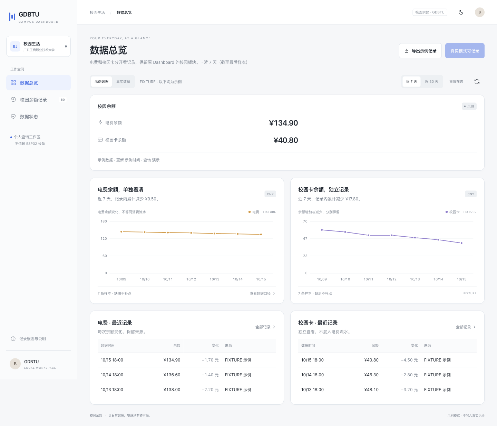
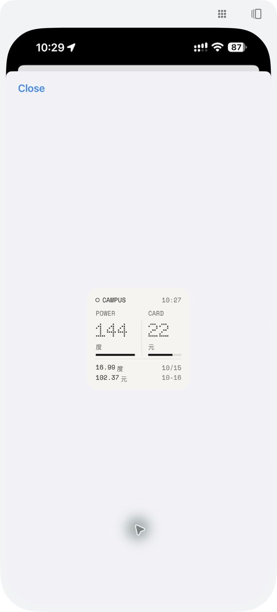
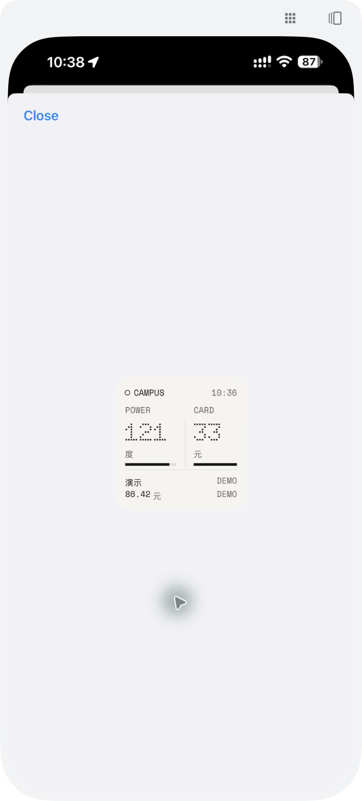
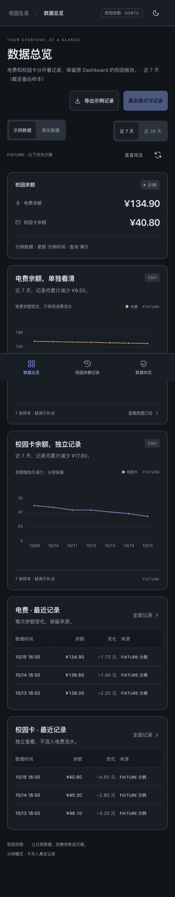

# 📱 校园余额 · GDBTU

广东工商职业技术大学的非官方校园余额查询工具。把校园卡余额和宿舍电费放到 iPhone 与电脑上查看：iPhone 使用 Scriptable 桌面小组件，电脑运行本地 Web Dashboard，同时保留原项目的点阵数字、校园卡片、走势图和记录表。

配置优先尝试从本人已登录的学校官方网页导出，复用已选宿舍的最终节点，减少手动查找和填写楼栋、楼层与房号。若当前网页登录环境不适用，教程也保留抓包备用方法。

📦 [下载 Scriptable 单文件](https://github.com/JasonBeam/gdbtu-campus-balance/releases/download/v0.1.0/campus-balance-v0.1.0.js) · [下载完整源码](https://github.com/JasonBeam/gdbtu-campus-balance/releases/download/v0.1.0/gdbtu-campus-balance-v0.1.0-source.zip) · [全部版本与附件](https://github.com/JasonBeam/gdbtu-campus-balance/releases/tag/v0.1.0)

📖 [iPhone 小组件安装](#iphone-小组件) · [电脑面板使用](#电脑面板)

🔗 [配置提取教程](docs/setup.md) · [AI 辅助上手](docs/ai-guide.md)

✨ [功能与使用方式](#选一种使用方式) · [界面预览](docs/previews.md) · [审查记录](docs/review.md)

> 当前版本为 **v0.1.0 实验性预发布**。官方页面配置导出已通过静态审查和模拟测试，真实登录后的完整流程仍待验证；不保证所有账号和客户端都能免抓包。本项目为非官方个人工具。



## 选一种使用方式

| 你想做什么 | 从这里开始 |
| --- | --- |
| 在 iPhone 桌面看余额 | [安装 Scriptable 小组件](#iphone-小组件) |
| 在电脑上看余额和记录 | [启动电脑面板](#电脑面板) |
| 不熟悉代码，想让 AI 带着操作 | [AI 使用教程：提示词、配置与排错](docs/ai-guide.md) |
| 已经装好，只差自己的参数 | [官方页面导出与抓包备用方法](docs/setup.md) |

## 这个项目能做什么

- **两种余额，分别查看**：查询校园卡余额、宿舍电费；电表提供剩余电量时，小组件也会显示。
- **尽量减少手填**：尝试从已登录的官方页面导出配置，复用已选宿舍的最终 ID，无需逐层抄写楼栋、楼层和房号。
- **失败有明确状态**：电费失败不阻断校园卡；保留上次有效值并标记缓存，缺失值不会显示成 0。
- **记录有来源**：校园卡与电费分别记录，区分学校更新时间和本机查询时间；余额变化不当作消费流水。
- **参数留在自己手里**：小组件使用 Keychain，面板使用本机配置；查询功能不需要 AI API Key。

## iPhone 小组件

 

左图是现用个人脚本的真实预览，右图是独立版的实机演示。两者分别说明原样式和独立版渲染效果，不代表独立版的真实账户查询已完成验收。

1. 安装 [Scriptable](https://scriptable.app/)。
2. 下载 [Scriptable 单文件 v0.1.0](https://github.com/JasonBeam/gdbtu-campus-balance/releases/download/v0.1.0/campus-balance-v0.1.0.js)，通过 iPhone 分享菜单导入 Scriptable；也可新建脚本，复制[仓库中的完整脚本](scriptable/%E6%A0%A1%E5%9B%AD%E4%BD%99%E9%A2%9D.js)。
3. 运行脚本，先选“预览演示数据”，确认界面能显示。
4. 按[配置提取教程](docs/setup.md)取得自己的配置，再选“导入官方页面配置”粘贴 JSON，或选“配置 / 更新参数”手动填写。
5. 选“查询并预览”，与官方页面的同一账户、同一宿舍结果核对。
6. 在主屏幕添加 Scriptable 小组件，选择该脚本。组件参数填 `demo` 可展示演示数据；查看自己的余额时，将组件参数留空。

支持 Small / Medium。Small 演示已在真实 iPhone 上检查；Medium 实机布局及后台刷新仍待验证。iOS 决定实际刷新时机，20 分钟是缓存与建议刷新间隔，不保证准点更新。

## 电脑面板

需要 Python 3.10 或以上，无需安装第三方 Python 依赖。macOS / Linux 可运行：

```bash
git clone https://github.com/JasonBeam/gdbtu-campus-balance.git
cd gdbtu-campus-balance
python3 server.py --demo
```

打开 <http://127.0.0.1:4186>，先看演示界面。这个模式不访问学校接口，不需要个人参数。Windows 若已安装 Python，可在项目文件夹中使用 `py -3 server.py --demo`，具体环境先检查是否满足 Python 3.10+。

接入自己的账户：

1. 按[配置提取教程](docs/setup.md)将个人配置保存为项目根目录的 `config.local.json`，字段结构见 [config.example.json](config.example.json)。
2. macOS / Linux 可执行 `chmod 600 config.local.json`，限制文件读取权限。
3. 在演示服务终端按 `Ctrl+C` 停止服务，再运行 `python3 server.py`；Windows 可使用 `py -3 server.py`。
4. 在面板切换到“真实数据”。如果此前停留在示例模式，直接打开 <http://127.0.0.1:4186/?mode=real>。

默认只监听本机 `127.0.0.1`。下面的手机宽度截图展示响应式布局，不表示电脑面板已向手机开放；iPhone 小组件会直接查询学校接口，无需电脑面板常驻。

<details>
<summary>查看手机宽度的 Web 页面截图（演示数据）</summary>



</details>

## 让 AI 带你完成第一次使用

[AI 使用教程](docs/ai-guide.md)包含两条路径：普通聊天 AI 逐步讲解，本机代码助手协助检查环境、启动演示与排错。也提供小组件安装、错误求助和界面调整的提示词。

可以先复制这一段：

```text
我想使用广东工商职业技术大学的校园余额项目：
https://github.com/JasonBeam/gdbtu-campus-balance
请先阅读当前 README、docs/setup.md 和 docs/ai-guide.md。
如果你不能读取链接，请明确告诉我需要提供哪些公开文档，不要猜测项目功能。
我的设备是【填写设备和系统】，我想用【iPhone 小组件 / 电脑面板】。
请先带我运行演示，再说明如何由我本人提取、填写和验证个人参数。
不要索取或读取我的 Token、个人配置文件、Keychain 或原始抓包。
每一步说明操作位置、预期结果；没有真实验证的步骤请明确标注。
```

AI 是可选的操作助手。它不能凭文字房号猜出系统 ID，也不能替代官方登录、解除微信限制或保证凭据长期有效。教程中的提示词不需要向本项目接入 AI 服务。

## 下载文件怎么选

当前 Release 为 [v0.1.0 实验性预发布](https://github.com/JasonBeam/gdbtu-campus-balance/releases/tag/v0.1.0)：

| 文件 | 适用场景 |
| --- | --- |
| `campus-balance-v0.1.0.js` | 只安装 iPhone 小组件 |
| `gdbtu-campus-balance-v0.1.0-scriptable.zip` | 小组件、配置示例、教程与许可 |
| `gdbtu-campus-balance-v0.1.0-source.zip` | 完整源码、电脑面板与工具 |
| `SHA256SUMS.txt` | 校验附件完整性 |

不使用 Git 也可以下载源码 ZIP，解压后进入包含 `server.py` 的文件夹运行。**本页与 AI 教程跟随 `main` 更新，v0.1.0 附件仍是对应版本的固定内容。**

## 参数、记录与使用边界

| 参数 | 用途 |
| --- | --- |
| `syscustid` | 官方会话的用户标识 |
| `acc_token` | 当前登录凭据，可能过期 |
| `areacode` | 学校区域代码，以自己的会话为准 |
| `buildingID` | 电费页面最终选中的宿舍节点，电费查询需要 |
| `custid` | 校园卡账户标识，单账户时尝试自动获取 |
| `userAgent` / `timestamp` | 可选的浏览器标识与已有会话时间字段 |

`buildingID` 不一定只代表楼栋，不能根据字段名称或房号猜值；`custid` 与 `syscustid` 也不能互换。获取方法见[配置教程](docs/setup.md)。

查询按 20 分钟缓存。Web 服务运行时后台检查，余额历史保存到本机 `private/campus.sqlite3`；没有学校更新时间时不补造历史，校园卡因此可能只有当前余额。只做余额查询和会话初始化，不提供充值、缴费、宿舍绑定或批量查询。

`config.local.json`、`private/` 和抓包文件已被 Git 忽略；这不代表 AI 工具不能读取它们。不要把个人配置、登录链接、Token、学号、宿舍信息或原始抓包发给 AI、上传 Issue 或公开分享。小组件使用独立 Keychain 前缀 `gdbtu_public_v1_`，保留旧个人脚本的配置。

## 安卓能用吗？

**数据查询逻辑有适配到安卓的基础，但目前没有安卓设备，尚未实测，不列为已支持平台。**

学校接口使用 HTTPS 请求，现有 Python 客户端也与 iPhone 显示层分开；这为安卓端适配提供了参考，但不能证明安卓上的登录、配置提取和余额查询已经可用。Scriptable 小组件面向 iPhone，不能直接安装到安卓，安卓桌面小组件需要另做适配。

当前电脑面板默认只在电脑本机访问，安卓浏览器也不能直接通过手机的 `127.0.0.1` 打开电脑面板。浏览器访问方案仍需单独配置和验证，不是现成的安卓支持。

欢迎有安卓设备的使用者提供脱敏测试反馈：设备与系统版本、运行方式、官方页面登录情况、配置提取和双余额查询结果。请勿提交个人参数或原始抓包。

## 进阶可选：ESP32 桌面屏

如果你还想把余额显示到独立桌面屏，可以进一步研究 ESP32 适配。这个项目的查询逻辑最初从个人 BeamJasonESP 工程中独立整理，相关来源见[审查记录](docs/review.md)。

硬件属于可选扩展，当前仓库的使用教程和下载包以 iPhone 小组件、电脑面板为主，不提供完整的 ESP32 固件、接线和刷写流程。接入桌面屏需要另行处理硬件驱动、凭据保存、数据格式与刷新策略，并在实际设备上验证。

## 验证与项目资料

```bash
python3 -m unittest discover -s tests -v
node tests/test_scriptable.cjs
node tests/test_export.cjs
```

自动测试、实际 Web 页面和 iPhone Small 演示渲染已有记录；独立版真实账户查询、微信内导出、Medium 实机布局和系统后台刷新仍待验证。详见[审查记录](docs/review.md)与[稳定版验收计划](docs/ROADMAP.md)。

[更新记录](CHANGELOG.md) · [贡献指南](CONTRIBUTING.md) · [安全反馈](SECURITY.md) · [MIT 许可](LICENSE)

本项目与广东工商职业技术大学、云间校园、Scriptable 无官方关联。请仅使用自己的合法会话，并遵守学校系统使用规则。Doto / Space Mono 字形素材附带 [SIL Open Font License](docs/licenses/)。
