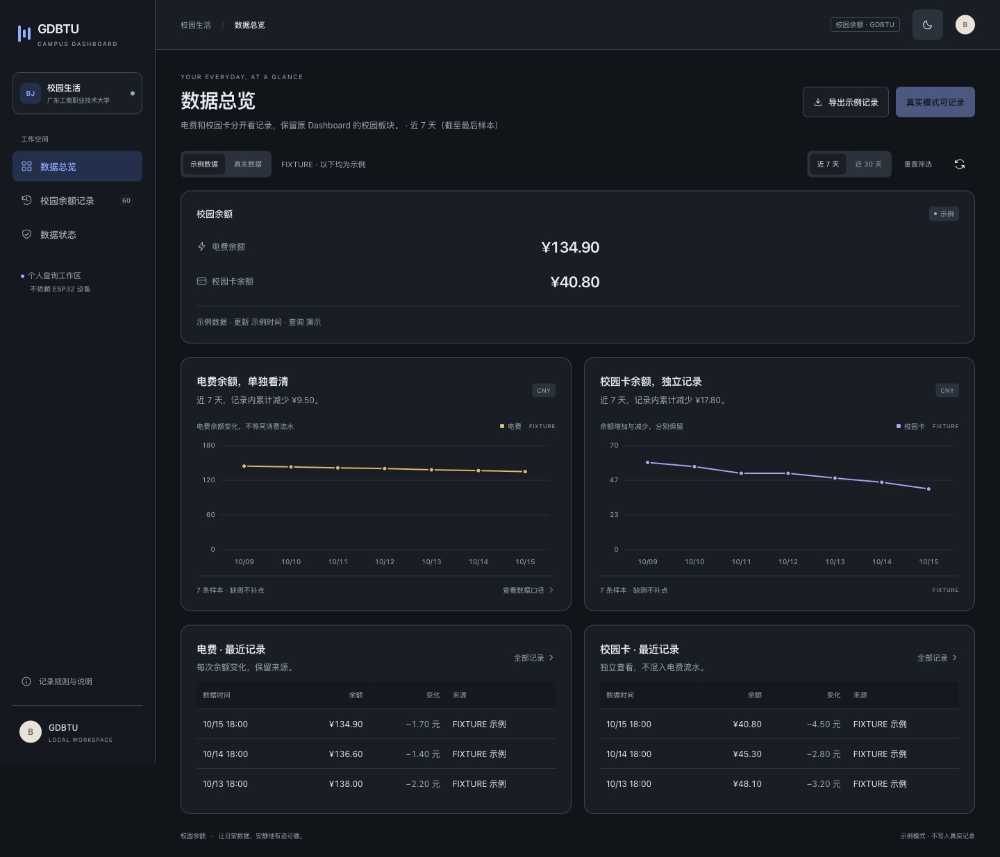

# 界面预览

[返回项目首页](../README.md)

这里展示 Scriptable 小组件与 Web Dashboard 的页面样式。请留意每张图片标注的数据来源：演示数据只用于预览，不代表真实查询或账单结果。

## iPhone · Scriptable

现用个人脚本的 iPhone 实机截图，用于展示原来的小组件样式。

独立版 Small 小组件演示渲染。它验证界面显示，不代表真实账户查询已完成验收。Small 已做实机预览；Medium 实机布局和系统后台刷新仍待验证。

## Web Dashboard

桌面布局，使用演示数据。

手机宽度布局截图只展示响应式页面；面板默认只在运行它的电脑本机访问，不表示手机可以直接连接电脑面板。

深色主题，使用演示数据。以上界面图均不能代替真实账户查询验收，验证范围见[审查记录](review.md)。
